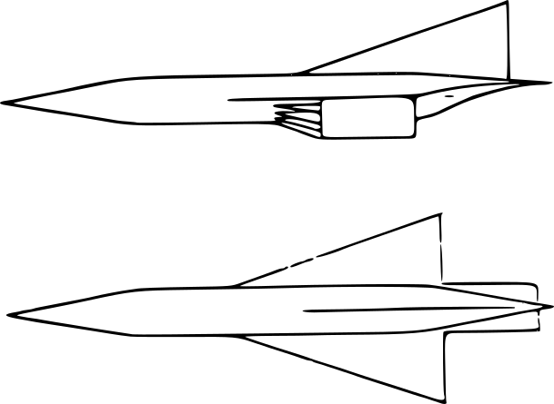

# Hypersonic Simulation Model Simulink

Simulink implementation of the 6-DOF Generic Hypersonic Aerodynamic Model Example (GHAME), a hypersonic aerodynamic model originally developed by NASA in 1989 as a simulation platform for the National AeroSpace Plane (NASP) program.

The original GHAME implementation was developed by Peter H. Zipfel as C++ code accompanying *Modeling and Simulation of Aerospace Vehicle Dynamics, Fourth Edition*. The reference implementation can be obtained from the AIAA website: https://arc.aiaa.org/doi/suppl/10.2514/4.107535

This Simulink model reproduces the original formulation. Simulation results have been cross-verified against the reference C++ implementation to ensure consistency and correctness.

The trimming procedure is based on the open-source **TrimMod** package and does not require the *Simulink Control Design Toolbox*.

The *Aerospace Blockset Toolbox* is only required for optional wind modeling functionality. This feature is commented out by default and can be activated if the toolbox is available.

The code has been tested and verified to run in MATLAB versions down to **MATLAB R2018b**.

## Overview

The simulation provides a full nonlinear 6-DOF flight dynamics model of the GHAME vehicle, including rigid-body translational and rotational dynamics, aeropropulsive force and moment modeling, environmental modeling, and Direction Cosine Matrix-based kinematics.

The model includes second-order actuator dynamics, a trimming routine for determining control surface deflections and thrust settings, and a configurable inertial navigation system (INS). The INS allows the injection of gyro bias, scale factor errors, misalignment effects, and measurement noise for analysis of estimation and control robustness.

No control or guidance system is included by default. The platform is intentionally provided as a research and control development framework, enabling users to design, implement, and test their own control architectures.

The overall simulation architecture is modular and structured to facilitate systematic extension. Additional subsystems such as GPS models, star trackers, advanced state estimation, guidance algorithms, or nonlinear control strategies can be integrated without restructuring the core dynamics model.

## Getting started

1. Clone the repository and open the project folder in MATLAB.
2. Adjust the scenario in the user section of `Helper Functions/Initialize_Simulation_Public.m`.
3. Run `Main_Public.m`. It loads the aerodynamic data, initializes the simulation, trims the vehicle and runs the nominal simulation, followed by the Monte Carlo runs if enabled.

## Author

Thomas Harald Müller, Hamburg, Germany
GitHub: https://github.com/ThomasHaraldMueller

Free to use and modify, provided the copyright notice is kept and the author is credited.
